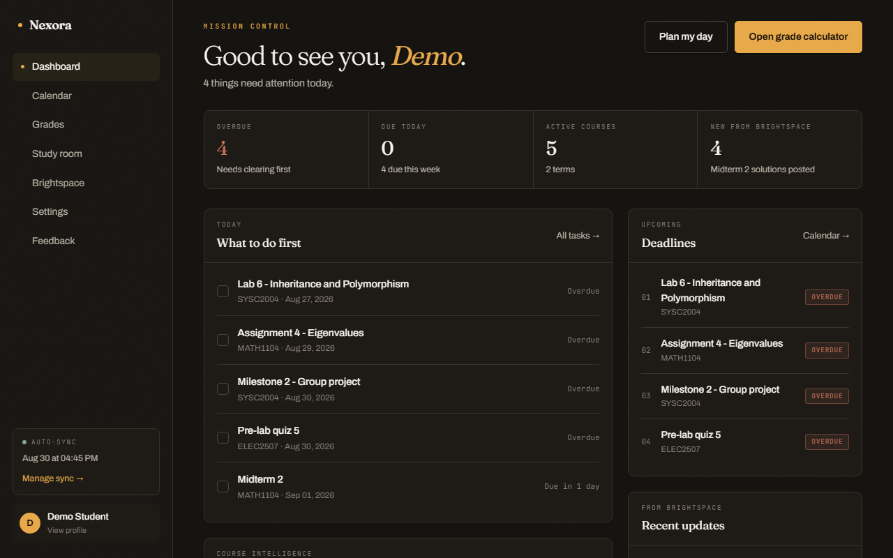

# Nexora

**An academic operating system for university students.** It pulls a student's
real coursework out of their learning-management system, reads their course
outlines with an LLM to build a grading model per course, and answers the
question every student actually has: *what do I need to do, and what will it do
to my grade?*

Live at **[uni-helper-project.onrender.com](https://uni-helper-project.onrender.com)**
· in private beta with students at Carleton University.



---

## What it does

| | |
|---|---|
| **Syncs coursework** | Brightspace via a purpose-built Chrome extension, Canvas via its API. Deadlines, lectures, announcements, grades. |
| **Reads course outlines** | An LLM extraction pipeline turns a PDF syllabus into an executable grading policy — weights, pass rules, alternative schemes, minimums. |
| **Computes grades honestly** | "What do I need on the final for a B+?", including courses whose outline defines multiple conditional schemes. |
| **Plans the week** | Deadline-aware study scheduling around a real timetable, weighted by what each assessment is worth. |
| **Calendar, tasks, study tools** | One month view, a prioritised queue, AI flashcards and summaries from the student's own lecture material. |

---

## Why the Chrome extension exists

**Brightspace has no student-facing API.** That is the entire reason. The
extension is a Manifest V3 worker that injects into the student's own
Brightspace session, reads D2L's internal endpoints, and posts to Nexora.

Two design rules hold it together:

- **The extension is transport only.** Every line that *interprets* an LMS
  payload lives on the server, once. Reimplementing parsing in JavaScript would
  mean two sources of truth for what a deadline is.
- **It is generic.** `location.origin` plus D2L's own `/d2l/api/le/` paths, so
  it works at any university rather than one. What once limited it to a single
  institution was Chrome's permission gate, not the code.

---

## Engineering notes

The interesting parts of this project are the bugs, not the features. A few
that shaped the architecture:

**A production database suspended for exceeding its storage.** One table held
786 MB across 2.58 million rows — 96% of the database. The first diagnosis was
wrong, and that is the useful part: the only column that *could* hold a
gigabyte was blamed from reading the schema, and it held 20.8 MB. Postgres'
own `n_live_tup` reported 4,758 rows against a real 2.58 million, because
`ANALYZE` had never run. The actual cause was an item being re-announced once
per sync, for ever, because a delete-then-reimport made the "has this changed"
comparison unreachable code. *Measure the thing; do not infer it from the
schema.*

**Every date is the student's day, not the server's.** A Brightspace deadline
at 11:59 PM Eastern is `03:59Z the next day`, so the commonest deadline time
in a university was displayed a day late — not blank, not obviously broken,
confidently wrong on the screen a student checks to decide what to do tonight.
Fixing it meant distinguishing three shapes of calendar timestamp, one of which
(a zone-less `DTSTART`) is indistinguishable from UTC after parsing and has to
be detected in the raw feed text.

**A rule the app cannot check must never fail a student.** Pass/fail evaluation
is tri-state — `True`, `False`, or `None` for a requirement that could not be
answered — because "cannot be evaluated" and "the student fell short" producing
the same answer meant a student with full marks on every component was shown
**FAIL · F**.

**A conditional grading scheme applies only when its condition holds.** A
course offering a "Missed Midterm Scheme" reported it as the student's grade
*with a midterm mark entered*, because the winner is the highest-scoring
eligible scheme and dropping an assessment redistributes its weight — so the
scheme that won was the one that should have been impossible. The gate is the
student explicitly marking an assessment as missed; an empty mark is not a
missed assessment, or the scheme would open months early.

**LLM work is measured, not argued.** Model selection is ordered by *observed
availability on the live key*, re-probed rather than trusted, because a stale
model table cost every call a timeout plus a 503 before anything answered. A
16-outline evaluation corpus guards the extraction prompt — each case isolating
one mechanism (bonus marks, overflow caps, alternative schemes, a syllabus
priced in points) — because without it you tune the prompt to whatever outline
is on the desk. And when asked to raise the model tier for the calendar, the
honest answer came with numbers: identical results at 5–18× the latency.

The full engineering log lives in [`CLAUDE.md`](CLAUDE.md) — every
non-obvious decision in this codebase with the bug that motivated it.

---

## Stack

**Python 3.12 · Flask · PostgreSQL · SQLAlchemy · Gemini · Chrome Manifest V3 · Render**

No ORM migrations framework: schema changes go through an explicit
self-migrating map applied at startup, because `create_all()` silently refuses
to add a column to a table that already exists — a failure that appears only in
production.

```
app.py            the application — routes, models, LLM calls, grade engine
extension/        Chrome extension (Brightspace scraper)
templates/        29 Jinja pages
tests/            1,252 tests
evals/            live-API evaluation corpus for the outline pipeline
scripts/          operational tooling (database audits, data repairs)
docs/             design documents and release notes
```

## Running it

```bash
python -m venv venv && venv/Scripts/pip install -r requirements.txt
venv/Scripts/python.exe app.py          # http://127.0.0.1:5000
```

Falls back to SQLite with no `DATABASE_URL`. Gemini features need
`GEMINI_API_KEY`; without it the app degrades to a deterministic parser rather
than failing.

```bash
venv/Scripts/python.exe -m pytest tests/ -q      # 1,252 tests
```

---

## Testing

Tests here are written to pin a *behaviour someone reported*, and each one is
confirmed to fail against the unfixed code before it lands — a test that passes
either way pins nothing. Several encode lessons that cost real time:

- **Pin invariants, never measurements.** A rate-limit test that sent exactly
  15 requests only ever worked because the limit happened to be 12.
- **A fixture dated in the past is a test with a timer on it.** Five files
  failed on five different days for reasons unrelated to what they tested,
  because the app deliberately stops carrying work far enough in the past.
- **Verify visibility by computed `display`, never by `el.hidden`** — a CSS
  class out-ranked the attribute and a feature shipped visibly broken under a
  passing test.

---

<sub>Built by [Bassem Abdo](https://github.com/BassemAbdo01). Source available for review; not licensed for reuse.</sub>
